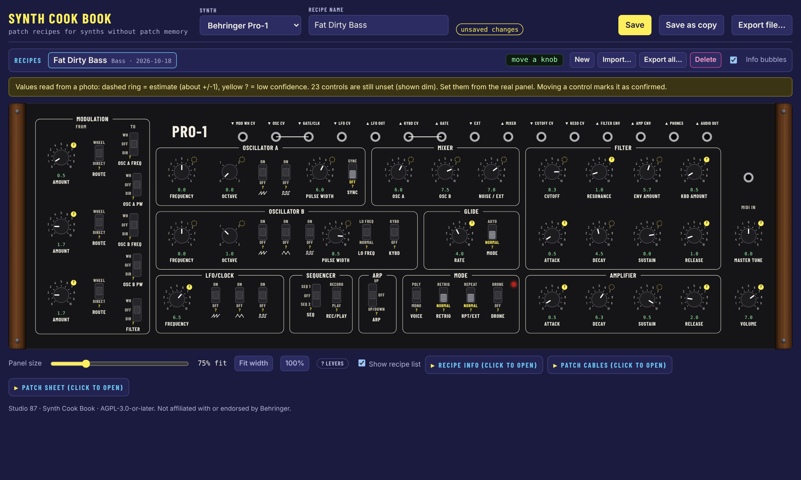

# Synth Cook Book 🐈

Preset cookbook (recipe book) for Behringer synths: Pro-1, CAT, TD-3-MO and TD-3. Works on Linux, macOS and Windows.

## Status
Usable: the Synth Cook Book (`docs/recipe-book.html`) draws the front panels of the Behringer Pro-1, CAT, TD-3-MO and TD-3 (pick one in the Synth menu) and stores your recipes in the browser; the release zip has it as an offline file with a short manual. No plugin build yet.

  

☕ Free and open source, made by one person. If it helps your music, a coffee on [Ko-fi](https://ko-fi.com/studio87) keeps it coming. 💜

## Docs
- [Device notes](docs/DEVICE-NOTES.md): what is confirmed from manuals, and what is still missing.
- [TD-3-MO notes](docs/TD-3-MO-NOTES.md): what the guide confirms; only CC 74 (cutoff) is known, so there is no TD-3-MO controller plugin.
- [Roadmap](ROADMAP.md)

## Patch book site
Browse and share patches in the browser: `docs/index.html` (GitHub Pages from `/docs`). Format: [docs/PATCH-FORMAT.md](docs/PATCH-FORMAT.md). How to share and switch Pages on: [docs/SHARING.md](docs/SHARING.md).

## License
AGPL-3.0-or-later, see [LICENSE](LICENSE).

Not affiliated with or endorsed by Behringer or Music Tribe. All trademarks belong to their owners.
